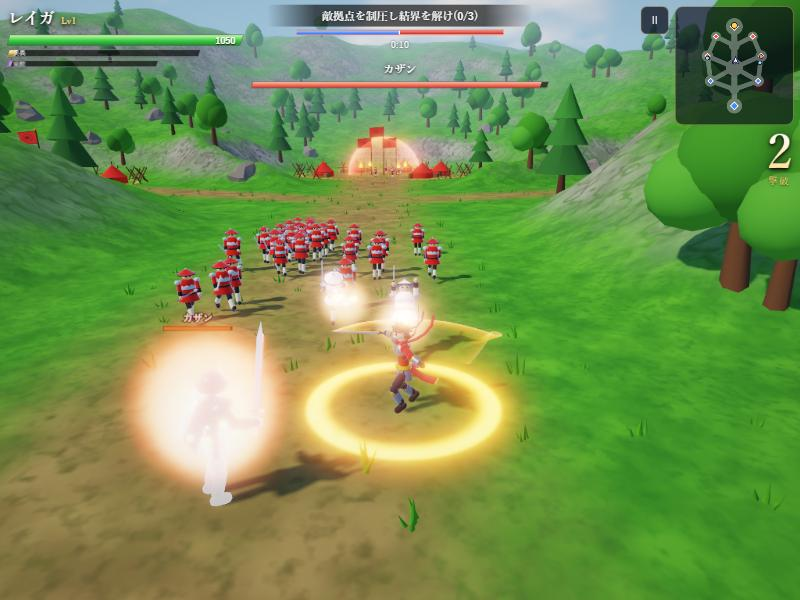
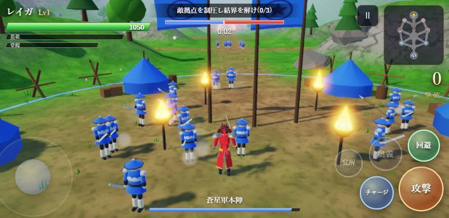
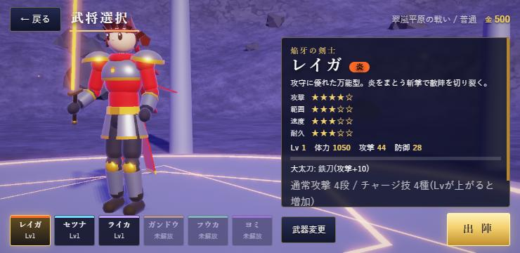

# 星牙戦記 SEIGA — Star Fang Chronicle

大軍をなぎ倒し、拠点を奪い合う **一騎当千タクティカルアクション**。
スマホのブラウザでそのまま動き、ホーム画面に追加すればアプリとして遊べます(PWA)。
画像・音声ファイルは一切使わず、3Dモデル・エフェクト・BGMまですべてコードで生成しているため、とても軽量です(全体で約1MB)。



| スマホ(横向き) | 武将選択 |
|---|---|
|  |  |

## 特徴

- **6人の武将**(大太刀・長槍・双剣・大槌・双扇・大鎌)。通常攻撃6段・チャージ技6種・奥義・覚醒
- **属性**: 炎(炎上)/ 氷(凍結)/ 雷(連鎖)/ 地(気絶)/ 風(打ち上げ)/ 闇(吸収)
- **5つの章+無限戦場**。拠点を制圧して敵本陣の結界を解き、総大将を討つ
- **やりこみ要素**: Lv99までの成長、武器収集(★1〜★5+神器・17種の特性)、鍛錬、錬成、実績26種、難易度5段階
- **セーブ**: 端末内に自動保存。設定すれば **Googleスプレッドシート** に同期して、別端末への引き継ぎ・全国番付が使えます

## 操作方法

| 操作 | タッチ | キーボード | ゲームパッド |
|---|---|---|---|
| 移動 | 画面左をドラッグ | W A S D | 左スティック |
| 視点 | 何もない所をドラッグ | ← → | 右スティック |
| 攻撃(押しっぱなし可) | 攻撃 | J / Z | □ / X |
| チャージ攻撃 | チャージ | K / X | △ / Y |
| 回避 | 回避 | L / Space | ✕ / A |
| 奥義 | 奥義 | I / V | ○ / B |
| 覚醒 | 覚醒 | U / B | R1 / L1 |
| 一時停止 | Ⅱ | P / Esc | Start |

- 通常攻撃の途中でチャージを押すと、段数に応じた技に派生します
- 敵将の武器が赤く光ったら強攻撃の合図。直前に回避すると「見切り」が発動します
- 敵拠点は兵を倒し続けると兵長が出現し、兵長を倒すと制圧できます

## パソコンで動かす(開発用)

Node.js が入っていれば、次のコマンドでローカルサーバーが起動します。

```bash
node tools/serve.mjs
```

ブラウザで http://localhost:5173 を開いてください。
(`index.html` を直接ダブルクリックしても動きません。必ずサーバー経由で開いてください)

## GitHub でアプリ化する(GitHub Pages)

1. GitHub で新しいリポジトリを作成(例: `seiga`。Public)
2. このフォルダの中身をすべてアップロード(またはpush)

   ```bash
   git init
   git add .
   git commit -m "星牙戦記 初版"
   git branch -M main
   git remote add origin https://github.com/<あなたのユーザー名>/seiga.git
   git push -u origin main
   ```

3. リポジトリの **Settings → Pages** を開き、**Source: Deploy from a branch**、**Branch: main / (root)** を選んで Save
4. 1〜2分後、`https://<あなたのユーザー名>.github.io/seiga/` で公開されます

### スマホにインストール

- **Android(Chrome)**: 公開URLを開く → メニュー「︙」→「アプリをインストール」(または「ホーム画面に追加」)
- **iPhone / iPad(Safari)**: 公開URLを開く → 共有ボタン → 「ホーム画面に追加」

ホーム画面のアイコンから起動すると、全画面のアプリとして動きます。一度開けばオフラインでも遊べます。

### ゲームを更新したとき

`sw.js` の先頭にある `CACHE = 'seiga-v1.0.0'` の番号を変更してからアップロードしてください。
(番号を変えないと、インストール済みの端末に古いファイルが残ります)

## Googleスプレッドシートでセーブする

セーブデータは何もしなくても端末内に自動保存されます。
下の設定をすると、**スプレッドシートにも自動保存**され、機種変更や別端末での続きプレイ、番付(ランキング)が使えるようになります。

1. [Googleスプレッドシート](https://sheets.new) を新規作成(名前は自由)
2. メニューの **拡張機能 → Apps Script** を開く
3. 最初から入っているコードをすべて消し、このフォルダの **`gas/Code.gs`** の内容を貼り付けて保存
4. 右上の **デプロイ → 新しいデプロイ** を押す
   - 種類の選択(歯車)→ **ウェブアプリ**
   - 実行ユーザー: **自分**
   - アクセスできるユーザー: **全員**
   - 「デプロイ」→ 初回は権限の承認を求められるので許可
5. 表示された **ウェブアプリのURL**(`https://script.google.com/macros/s/…/exec`)をコピー
6. 次のどちらかに貼り付け
   - **全プレイヤー共通にする**: `src/config.js` の `CLOUD_URL = ''` の `''` の中に貼る(GitHubに上げ直す)
   - **自分の端末だけで試す**: ゲーム内 **設定 → スプレッドシート連携 → 連携URL** に貼る

設定後は、合戦が終わるたびにシート `saves` へ自動保存されます(1プレイヤー1行)。
番付は `ranking` シートに記録されます。

### 別の端末へ引き継ぐ

1. 元の端末の **設定** に表示される **引き継ぎコード** を控える
2. 新しい端末でゲームを開き、同じ連携URLを設定
3. **設定 → データ復元** に引き継ぎコードを入力して「読み込む」

### 注意

- 連携URLを知っている人は誰でも書き込めます(趣味の公開用途を想定した簡易的な仕組みです)。
  引き継ぎコードは合言葉のようなものなので、他人に教えないでください
- `gas/Code.gs` を書き換えたら、**デプロイ → デプロイを管理 → 編集 → バージョン: 新バージョン** で再デプロイが必要です

## ファイル構成

```
index.html            画面の骨組み
css/style.css         UIのスタイル
src/
  main.js             起動・メインループ・画面遷移
  config.js           連携URLなどの設定
  data.js             武将・ステージ・武器・実績のデータ
  moves.js            技(モーションと攻撃判定)のデータ
  battle.js           合戦の進行(拠点・増援・勝敗・カメラ)
  fighter.js          武将(プレイヤー・敵将・味方将)とAI
  horde.js            雑兵の大群(インスタンス描画・AI)
  stage.js            地形・拠点・経路
  models.js / rig.js  キャラクターモデルと手続き型アニメーション
  fx.js               エフェクト
  gfx.js              描画(HDR・ブルーム・影・画質自動調整)
  audio.js            効果音とBGM(シンセ生成)
  input.js            タッチ・キーボード・ゲームパッド
  ui.js               HUDとメニュー
  save.js             セーブとスプレッドシート連携
  lobby.js            メニュー背景の3D表示
vendor/               Three.js(MITライセンス)
gas/Code.gs           スプレッドシート側のスクリプト
manifest.webmanifest  アプリ情報(PWA)
sw.js                 オフライン対応
icons/                アプリアイコン(tools/make-icons.mjs で再生成可能)
tools/                開発用サーバーなど
```

## 改造のヒント

- **難易度・敵の強さ**: `src/data.js` の `DIFFS`、`src/battle.js` の `_scale()`
- **ステージを増やす**: `src/data.js` の `STAGES` に追加(`nodes` が広場、`links` が道、`bases` が拠点)
- **技を調整する**: `src/moves.js`(`slash` / `thrust` / `spin` / `smash` / `dash` を組み合わせて定義)
- **武将の見た目**: `src/data.js` の `HEROES[].look`(髪型・装備・配色)

## ライセンス

- ゲーム本体のコード・データ: 自由に改変・公開してかまいません
- [Three.js](https://threejs.org/): MIT License(`vendor/THREE-LICENSE.txt`)

## クレジット

- 音楽: 魔王魂(https://maou.audio/) — CC BY 4.0
  - 民族32「初詣」/ 民族33「和bravery heart」/ ネオロック73「夕日の沈む丘へ」/ オーケストラ23「be proudly」/ オーケストラ24「crisis」/ オーケストラ25「神々の試練」/ オーケストラ26「戦いの跡」
- [three-vrm](https://github.com/pixiv/three-vrm): MIT License(`vendor/THREE-VRM-LICENSE.txt`)
- 雑兵・背景の3D素材: [Quaternius](https://quaternius.com/)(Ultimate Animated Character Pack / Stylized Nature MegaKit)— CC0
